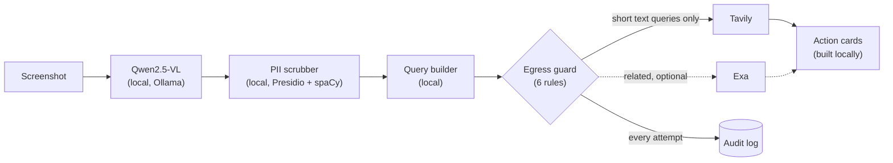

<p align="center">
  <picture>
    <source media="(prefers-color-scheme: dark)" srcset="docs/brand/lockup-dark.png">
    
  </picture>
</p>

# PrismLocal

**Your screenshots, turned into actions, without your screenshots leaving your laptop.**
A local-first memory agent built for HACK1984.

Drop a screenshot. A vision model running on your machine (Ollama + Qwen2.5-VL) works out what you
meant to do and pulls out the public facts; a deterministic scrubber removes anything private; only
short text queries built from public facts go to Tavily (and Exa). PrismLocal answers in a chat: its
work steps tag every stage On device or Internet, then it replies with action cards (tickets, a map
pin, a calendar file it makes only after you say yes) and a privacy receipt of what left.

## Demo

[TBD: demo GIF, recorded from a real run; put it at `docs/demo.gif` and embed it here.]

The demo runs on the chat screen: drop a concert screenshot, follow the work steps, approve **Add to
calendar**, then turn on **Air-gap**, drop an internal email, choose **Turn off and finish** and
open **Receipts**. Record the GIF from that screen; the classic layout stays at `?view=classic`.

- Backup video (90 s): [TBD: link to the recorded backup video]
- Demo script, checklist and fallback plan: [`docs/DEMO.md`](docs/DEMO.md)

## Architecture



Everything left of the egress guard runs on this machine. The image bytes stay in memory for the
extraction and are then dropped; they are never logged or sent, and never written to disk unless
you opt in to library thumbnails (`LATENT_KEEP_THUMBS=1` stores a 256 px JPEG on this machine).

## How privacy is enforced

Privacy in PrismLocal is **enforced and auditable**, not mathematically guaranteed: the rules below are
code with tests, and every outbound request is recorded so you can check what left.

**One door to the network.** Only `backend/app/egress.py` opens network connections
(`backend/tests/test_single_egress.py` fails if any other module in `backend/app` opens a
network client). Ollama is reached
only through a loopback-only client. Every internet request passes these rules in order; the first
failure blocks it:

1. Air-gap: `LATENT_OFFLINE=1` or the **Air-gap mode** switch in the UI blocks everything.
2. The host must be on the allow-list (`api.tavily.com`, `api.exa.ai`), over https on the default
   port.
3. The JSON body must be at most 4096 bytes, so an image cannot fit.
4. No base64-looking run of 200+ characters in the body.
5. The PII checker finds nothing in any string of the body (only kept performer and author names
   are allowed through).
6. No API key in the body. Keys come from the environment, travel only in the request header, and
   are redacted from every record, log line and event.

Every attempt, sent or blocked, is recorded with its exact byte count and a payload preview: in the
chat's **Receipts** drawer (query text and size; the receipt under each reply opens that turn's
requests), in the classic view's **Audit log** drawer (with the payload preview), at
`GET /api/egress`, and in `backend/egress.log`.

**Scrubber policy** (`backend/app/pipeline/scrub.py`, runs locally on everything the model
returns):

- Any entity with an email address, phone number, credit card, SSN, IBAN, IP address, US bank
  number, social handle or account/order/invoice ID is removed, whatever its type.
- Person names are removed unless the entity is a performer or author (public names you would
  search for).
- Runs of 6+ digits are removed outside dates, times and prices.
- For documents (emails, chats, internal docs) only `topic`, `public_org` and `product` entities
  are kept; everything else is dropped.
- The summary is cleaned too, but it is never sent: queries are built only from kept public
  entities, by templates in `backend/app/pipeline/query.py`.

**Leak eval.** `eval/` holds ten synthetic screenshots full of planted fake personal data and a
script that runs the local pipeline offline and fails on any leak:
`LATENT_OFFLINE=1 python eval/run_eval.py`. Latest results (`eval/results.md`):
[TBD: leaks, intent accuracy, entity recall and latency from a real run on the demo laptop; the
eval needs Ollama and has not been run yet].

## Setup in 3 commands

Needs Python 3.11+, Node 20.19+ and [Ollama](https://ollama.com/download) 0.7+ (details below).

```bash
git clone https://github.com/yashkava05/Leo369_Hack1984.git latent && cd latent
./scripts/setup.sh    # .env, model pull + smoke test, backend venv, spaCy model, frontend deps
./scripts/dev.sh      # backend on :8000, frontend on http://localhost:5173
```

Put your `TAVILY_API_KEY` (and optionally `EXA_API_KEY`) in the gitignored `.env.local`, open http://localhost:5173 and
drop `eval/screenshots/concert_ig.png` on the chat (or click **Try a concert flyer**).

The backend reads root/backend `.env` files, then root/backend `.env.local` overrides;
shell environment variables take precedence over all of them. Restart the backend after changing
a key. Keep keys unprefixed: never use `VITE_EXA_API_KEY`, which would expose a key to the browser.

## Track alignment

| Track | How PrismLocal meets it |
| --- | --- |
| **Privacy-First** | Vision runs locally; one egress module with six rules; work steps tagged On device or Internet; air-gap switch; a privacy receipt per reply and a log of every outbound request and its size; leak eval on fake-PII screenshots. |
| **SURGE (Tavily & Exa)** | Tavily search turns scrubbed public entities into ticket, shop, book and insight cards (calendar and map cards are built on-device); Exa adds related-reading cards for books, charts and documents when a key with credits is set. |
| **Most Startup-able** | A problem everyone has; free for consumers with an affiliate share on tickets, products and books (one hook, `affiliate.tag_url`, passes through today); a planned enterprise tier with an on-prem model, admin policy and audit-log export. |

## Team

[TBD: names and roles]

## Prerequisites

- Python 3.11+
- Node 20+ (Vite needs 20.19 or newer)
- [Ollama](https://ollama.com/download) 0.7+ (see [Local model setup](#local-model-setup-ollama--qwen25-vl))
- About 600 MB of disk for the spaCy `en_core_web_lg` model the local PII scrubber uses (setup installs it)

## Quick start

Step by step:

```bash
git clone https://github.com/yashkava05/Leo369_Hack1984.git latent
cd latent
./scripts/setup.sh          # .env, Ollama model pull + smoke test, backend/.venv, spaCy model, frontend deps
```

Then start everything with one command (Ollama if needed, the backend on :8000, the frontend on
:5173; Ctrl+C stops both servers):

```bash
./scripts/dev.sh
```

Or run each server in its own terminal:

```bash
# Terminal 1: backend on http://localhost:8000
cd backend && source .venv/bin/activate && uvicorn app.main:app --reload --port 8000

# Terminal 2: frontend on http://localhost:5173
cd frontend && npm run dev
```

Open http://localhost:5173 for the chat: attach or paste a screenshot, follow the on-device/web
steps, then review its cards and privacy receipt. Try the four sample chips with
`cd frontend && VITE_MOCK=1 npm run dev` to use fixtures without a backend or API keys.
Explicitly kept cards live in this browser's `localStorage` under `latent:kept`; screenshots
and the conversation are never persisted by the chat. Fonts are served locally too.

The original Terminal + Dashboard layout remains at http://localhost:5173/?view=classic,
including health banners. The Vite dev server proxies `/api` to the backend.

<details><summary>Manual setup (instead of scripts/setup.sh)</summary>

```bash
cp .env.example .env
cd backend && python3 -m venv .venv && source .venv/bin/activate && pip install -e ".[dev]"
cd ../frontend && npm install
```
</details>

## Local model setup (Ollama + Qwen2.5-VL)

The vision model runs on your own machine through Ollama (0.7 or newer). `./scripts/setup.sh`
starts `ollama serve` if needed, pulls `qwen2.5vl:3b` (about 3.2 GB), and asks the model to read
`scripts/smoke.png`. It prints `smoke test passed in Ns`, then installs the backend into
`backend/.venv` (or your active virtualenv), including the spaCy `en_core_web_lg` model for the PII
scrubber (pinned in `backend/pyproject.toml`, about 600 MB), checks that the model imports, and
runs `npm install` in `frontend/`. Re-running it is safe. `LATENT_SKIP_NPM=1` skips the frontend
install.

Check it end to end (from the repo root, with the backend venv active):

```bash
uvicorn app.main:app --port 8000 --app-dir backend &
sleep 20 && curl -s localhost:8000/api/health
# {"status":"ok","ollama":"up","model":"qwen2.5vl:3b","model_loaded":true,"tavily_key":true}
```

The backend warms the model on startup (`keep_alive: 30m`; skipped when `LATENT_MOCK=1`).
`status` is `ok` once Ollama is up and the model is pulled; `model_loaded` says whether it is in
memory right now. If Ollama is not running, `/api/health` still returns 200 with
`"status": "degraded"` and `"ollama": "down"`. `tavily_key` only says whether a key is set; the
key itself is never returned or logged.

**Hardware.** The 3B model runs on CPU, but expect roughly 10–40 s per screenshot; on Apple
Silicon or a GPU it takes a few seconds. With 16 GB+ RAM or a good GPU you can use the 7B model:
set `LATENT_MODEL=qwen2.5vl:7b` in `.env` and re-run `./scripts/setup.sh`.

**Windows.** `setup.sh` and `dev.sh` are for macOS and Linux (or WSL). On Windows, clone the repo
onto the Windows drive (for example `C:\src\latent`, not `\\wsl.localhost\...`), install Python
3.11, Node 20.19+ and [Ollama for Windows](https://ollama.com/download/windows), then double-click
`scripts\start-windows.cmd`. It checks the prerequisites (printing a fix for each missing one),
creates `.env` if there is none (never touching an existing `.env` or `.env.local`), pulls the model,
installs `backend\.venv` (including `en_core_web_lg`) and the frontend dependencies when they are
missing or changed, starts the backend and frontend, waits for `/api/health` and opens the chat.
Ctrl+C or closing the window stops both servers. From PowerShell:

```powershell
powershell -ExecutionPolicy Bypass -File scripts\start-windows.ps1 -Check   # readiness report only
scripts\start-windows.cmd -Mock      # replay fixtures: no Ollama, no network
scripts\start-windows.cmd -AirGap    # start with every outbound request blocked
scripts\start-windows.cmd -Wsl       # bind to 0.0.0.0 so WSL can reach the app (and Ollama, if started here)
```

See [`docs/DEMO.md`](docs/DEMO.md#windows-demo-laptop) for the demo-laptop routine.

## Configuration

Copy `.env.example` to the repo-root `.env` for defaults and put private overrides in
`.env.local`. The backend reads both with `pydantic-settings` (including backend-specific
overrides); Vite exposes only the `VITE_*` variables to browser code.

| Variable | Default | Used by |
| --- | --- | --- |
| `OLLAMA_HOST` | `http://localhost:11434` | backend |
| `LATENT_MODEL` | `qwen2.5vl:3b` | backend |
| `TAVILY_API_KEY` | empty | backend |
| `EXA_API_KEY` | empty | backend |
| `LATENT_MOCK` | `0` | backend |
| `LATENT_WATCH_DIR` | empty (off) | backend, see [Auto-ingest](#auto-ingest-from-the-screenshot-folder) |
| `LATENT_DB_PATH` | `~/.latent/latent.db` | backend (intent library) |
| `LATENT_KEEP_THUMBS` | `0` | backend (intent library) |
| `DEMO_FALLBACK` | `0` | backend, see [`docs/DEMO.md`](docs/DEMO.md#fallback-plan) |
| `VITE_API_URL` | empty (same origin, via the Vite `/api` proxy) | frontend |
| `VITE_MOCK` | `0` | frontend |

## Auto-ingest from the screenshot folder

Opt-in and off by default. Set `LATENT_WATCH_DIR` to a folder and every new screenshot saved there
starts a job within about a second; the classic view (`?view=classic`) shows a "Watching
~/Desktop" pill and follows the newest job unless you are in the middle of one. The chat screen
does not show watched jobs yet.

```bash
LATENT_WATCH_DIR=~/Desktop uvicorn app.main:app --port 8000   # from backend/
```

- Find the macOS screenshot folder with `defaults read com.apple.screencapture location`. If that
  prints "does not exist", screenshots go to the default, `~/Desktop`.
- Only new `.png`, `.jpg`, `.jpeg` and `.webp` files are picked up (including the macOS
  temp-name-then-rename save); hidden and temp files, files over 10 MB and files already in the
  folder are ignored (renaming one of them does not count as new). A file must stop growing for 500 ms before it is read, so half-written
  files never start a job.
- PrismLocal only reads the file. It never moves, edits or deletes anything in the folder, and the
  image bytes stay on this machine exactly as with a dropped screenshot.

## Intent library

Every finished job is saved on this machine in a SQLite database at **`~/.latent/latent.db`**
(override with `LATENT_DB_PATH`). Nothing is stored remotely. A row holds only the scrubbed
result: the intent summary, the public entities and the cards, with the egress records removed.
Screenshot thumbnails (256 px JPEG) are stored only when `LATENT_KEEP_THUMBS=1`. The file is not
encrypted; it relies on your user account's file permissions.

The **Library** drawer in the classic view (`?view=classic`) searches saved intents by
performer, product, place or any other public entity (SQLite FTS5), filters by type, reopens a
result's cards in the dashboard, and deletes one entry or everything ("Delete everything" also runs `VACUUM`). The same data is
under `GET /api/library?q=&type=&limit=50`, `GET /api/library/{id}`, `DELETE /api/library/{id}`
and `DELETE /api/library`. To inspect it directly:

```bash
sqlite3 ~/.latent/latent.db 'select intent_type, summary from intents order by created_at desc limit 5;'
```

## Local voice and reviewed text

Click the **microphone icon** beside the screenshot attachment button in chat
(or below the classic screenshot drop zone) to open voice input. Record up to 30 seconds, stop, review/edit the text,
then choose **Explore**, **Save locally**, or **Find related**. Typed input uses the
same review and local interpretation without microphone access. Find related requires
one selected library item and searches only that item's scrubbed public details.
Save locally stores a scrubbed intent in the library without any internet request.

Voice is optional. With the backend environment activated:

```bash
cd backend
python -m pip install -e '.[voice]'
cd ..
./scripts/setup_voice.sh
```

The script explicitly installs the pinned `Systran/faster-whisper-base.en` model
(about 150 MB; additional Python dependencies need extra space) and runs an offline,
in-memory smoke transcription. Set `LATENT_VOICE_PYTHON` if your Python environment
is outside `backend/.venv`. Runtime never downloads a model. Defaults:

```env
LATENT_STT_MODEL_PATH=~/.latent/models/faster-whisper-base.en
LATENT_STT_DEVICE=cpu
LATENT_STT_COMPUTE_TYPE=int8
```

Transcription is English-only, CPU int8 by default; the first request loads the model
and can take longer. Latency depends on CPU and recording length. Browser recording
requires localhost or HTTPS and permission, and chooses WebM/Opus, MP4, then Ogg/Opus
according to browser support. The backend also accepts WAV, validates container bytes,
and caps uploads at 8 MiB and decoded audio at 30 seconds. Unsupported recording,
permission denial, missing models, and silence offer a typed fallback.

Audio is decoded only in memory and never stored or logged. Raw/edited transcripts
are review-only and never enter job events, the local library, or audit records.
Only local Ollama receives reviewed text; only provenance-checked queries from scrubbed
public entities can reach Tavily/Exa. No Gradium/cloud transcription key is used.
Air-gap mode allows transcription, local interpretation, and save while blocking
external searches. Install the STT and Ollama models before going offline.

`VITE_MOCK=1 npm run dev` in `frontend/` provides event, save-only, selected-context
related, silence, and permission-denied demos without a microphone or backend.
`LATENT_MOCK=1` replays local voice results without loading Whisper or Ollama.

## Checks

```bash
cd backend && pytest                    # tests
cd backend && ruff check . && ruff format --check .   # lint + format
cd frontend && npm run lint && npm run build          # lint + type-check + build
```

## Layout

```text
backend/app/            FastAPI app (main.py, models.py, jobs.py, egress.py)
backend/app/pipeline/   extract -> scrub -> query -> search -> cards
backend/fixtures/       test fixtures
backend/tests/          pytest suite
frontend/src/           Vite + React + TS (api/, components/, types.ts, App.tsx, main.tsx)
eval/                   screenshots/, expected.json, run_eval.py
scripts/setup.sh        one-shot local setup
scripts/start-windows.* Windows: check, set up and start in one step
```

## Pitch deck

- [`docs/pitch.pdf`](docs/pitch.pdf): the 7-slide deck for the submission.
- [`docs/pitch-notes.pdf`](docs/pitch-notes.pdf): the same slides with speaker notes under each one.
- [`docs/pitch.html`](docs/pitch.html): the source. Open it in any browser to present
  (arrow keys or click to move, `F` fullscreen, `N` speaker notes). Edit the text in the file; no
  build step and no network needed.

Every `[TBD: ...]` in the deck must be filled before presenting: the eval numbers come from
`eval/results.md`, the stills from a real run. To re-export, open `docs/pitch.html` in Chrome and print
to PDF with margins "None" and background graphics on (`docs/pitch.html?notes` for the notes copy), or:

```bash
chrome --headless --no-pdf-header-footer --print-to-pdf=docs/pitch.pdf docs/pitch.html
```

## Team rules

- One branch per issue, named `<number>-<slug>` (for example `1-repo-scaffold`).
- Every PR body includes `Closes #<number>`.
- Never push directly to `main`.

## Mock mode

The pipeline contract lives in `backend/app/models.py` and is mirrored in `frontend/src/types.ts`.
Fixture runs (`concert_flyer`, `sensitive_doc`) let the UI be built without Ollama or Tavily:

- Backend: `LATENT_MOCK=1 uvicorn app.main:app --port 8000` replays a fixture for every upload
  (`sensitive_doc` when the filename contains "doc", otherwise `concert_flyer`).
- Frontend: `VITE_MOCK=1` makes `analyze()` and `subscribe()` in `src/api/events.ts` replay the
  same fixtures with no backend running.

Fixtures live in `backend/fixtures/` and are copied to `frontend/src/api/fixtures/`;
`pytest tests/test_contract.py` checks both copies against the models.

### Links visible in screenshots

Upload a public Links-panel screenshot to extract visible URLs locally. Complete URLs become
Open/Copy cards; cut-off or unclear URLs require review, and hidden suffixes are never filled in.
No linked page is fetched automatically, no URL is sent to Tavily/Exa, and these unreviewed link
results stay in the current session rather than being saved to history. On macOS, an optional
Apple Vision OCR pass uses the installed Swift command-line tools; other platforms use the
local vision-model response, whose links require manual review before opening. URL transcription is best-effort, so check case-sensitive short links.
