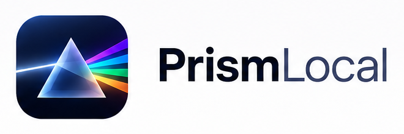
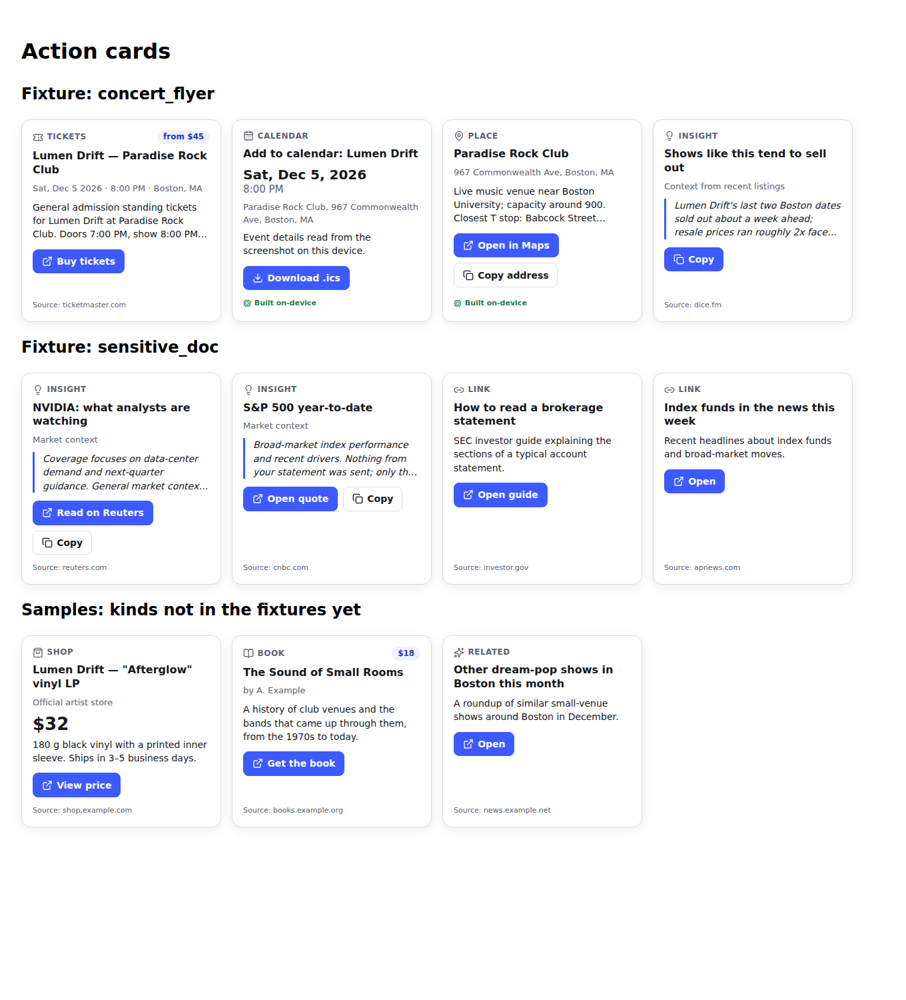
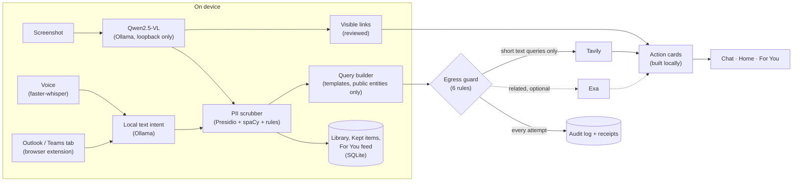

<p align="center">
  <picture>
    <source media="(prefers-color-scheme: dark)" srcset="docs/brand/lockup-dark.png">
    
  </picture>
</p>

<h3 align="center">Your screenshots, turned into actions, without your screenshots leaving your laptop.</h3>

<p align="center">
  A local-first memory agent built for <b>HACK1984</b>.
</p>

<p align="center">
  
  
  
  
  
  
  
  
  
</p>

---

You screenshot things you mean to come back to: a concert flyer, a product, a book, a place, a chart,
an email. PrismLocal turns each one into something you can act on. A vision model **running on your
own machine** works out what you meant and pulls out the public facts; a deterministic scrubber removes
anything private; only short text queries built from those public facts go to the web. The answer
arrives in a chat: live work steps tag every stage **On device** or **Internet**, then PrismLocal
replies with action cards (tickets, a shop link, a map pin, a calendar file it makes only after you say
yes) and a **privacy receipt** of exactly what left the device.

## Contents

- [Demo](#demo)
- [Features](#features)
- [How it works](#how-it-works)
- [Privacy guarantees](#privacy-guarantees)
- [Tech stack](#tech-stack)
- [Quick start](#quick-start)
- [Configuration](#configuration)
- [Mock and air-gap modes](#mock-and-air-gap-modes)
- [Browser extension (Outlook and Teams)](#browser-extension-outlook-and-teams)
- [Local voice](#local-voice)
- [Project structure](#project-structure)
- [Tests and checks](#tests-and-checks)
- [Hackathon tracks](#hackathon-tracks)
- [Roadmap and future scope](#roadmap-and-future-scope)
- [Pitch deck and docs](#pitch-deck-and-docs)
- [Team](#team)
- [License](#license)

## Demo

[TBD: demo GIF, recorded from a real run; put it at `docs/demo.gif` and embed it here.]

The demo runs on the chat screen (`?view=chat`): drop a concert screenshot, follow the work steps,
approve **Add to calendar**, then turn on **Air-gap**, drop an internal email, choose **Turn off and
finish** and open **Receipts**.

- Backup video (90 s): [TBD: link to the recorded backup video]
- Demo script, checklist and fallback plan: [`docs/DEMO.md`](docs/DEMO.md)

<p align="center">
  
</p>

## Features

### Screens

| Screen | URL | What it does |
| --- | --- | --- |
| **Home** | `/` | The Prism dashboard: drop or pick a screenshot, speak a thought, see action cards and the privacy mode at a glance. |
| **Chat** | `?view=chat` | A Muse-style thread. Attach or paste a screenshot; a live **work steps** message tags every stage *On device* or *Internet*; PrismLocal replies with cards, asks before acting, and attaches a privacy receipt to each reply. |
| **For You** | `?view=for-you` | A private, finite feed built from what you kept: connections between saved items ("these three things mention the same artist"), ready actions, and optional discovery. Give feedback per item or refresh. |
| **Classic** | `?view=classic` | The original Terminal + Dashboard layout with health banners, stage strip, live terminal log, audit log drawer, library drawer and the watched-folder pill. |

### Understanding screenshots, on device

- **Local vision extraction.** `qwen2.5vl:3b` through Ollama reads the screenshot and returns the
  intent (event, product, book, place, chart, document, other), a summary and typed entities.
- **Deterministic PII scrubber.** Presidio + spaCy `en_core_web_lg` plus fixed rules remove private
  data before anything else sees it.
- **Links visible in screenshots.** URLs in a screenshot (for example a Links panel) are extracted
  locally and become **Open / Copy** link cards. Cut-off or unclear URLs require your review, hidden
  suffixes are never guessed, authentication parameters are blocked, and no linked page is fetched
  automatically. On macOS an optional Apple Vision OCR pass improves accuracy.

### Web results, built from public facts only

- **Tavily search** turns scrubbed public entities into ticket, shop, book and insight cards.
- **Source citations.** Result and quick-answer cards cite the Tavily pages they came from.
- **Exa related reading** (optional) adds related cards for books, charts and documents when
  `EXA_API_KEY` is set and has credits.
- **On-device cards.** Calendar and map/place cards are built locally; nothing is searched for them.
- **Calendar export.** **Add to calendar** generates an `.ics` file in the browser, only after you
  approve it.

### Memory that stays on your machine

- **Kept items.** Keep any reply's cards; they are stored in a local SQLite database
  (`~/.latent/latent.db`), with browser storage holding only previews and an offline queue. Pin or
  delete items, or reset all memory.
- **Intent library.** Every finished job is saved locally as its scrubbed result (summary, public
  entities, cards). Search it with SQLite FTS5 in the classic view's **Library** drawer, reopen or
  delete entries. Thumbnails are stored only if you opt in (`LATENT_KEEP_THUMBS=1`).
- **For You feed.** Built from those local, scrubbed records. Optional discovery sends one
  deterministic query through the same egress guard.
- **Screenshot-folder watcher** (opt-in). Set `LATENT_WATCH_DIR` and every new screenshot saved
  there starts a job; PrismLocal only reads files, never moves or deletes them.

### Voice and connected apps

- **Local voice input.** Speak a request (up to 30 s); faster-whisper transcribes it on device, you
  review and edit the text, then choose **Explore**, **Save locally** or **Find related**. Audio is
  never stored or logged.
- **Outlook and Teams readers.** A read-only Chrome MV3 extension (`browser-extension/`) lets
  PrismLocal read one Outlook tab or one Teams chat or channel that you explicitly share, for one
  request you reviewed. Analysis runs on the local model; tasks must quote the message verbatim.

### Privacy you can see

- **Air-gap switch.** One toggle (or `LATENT_OFFLINE=1`) blocks every outbound request. Extraction,
  voice and saving still work locally.
- **Privacy receipts.** Every reply carries a receipt; the **Receipts** drawer shows every request
  that was sent or blocked, with its exact query text and byte size.
- **Audit log.** Every attempt is also at `GET /api/egress`, in `backend/egress.log`, and in the
  classic view's **Audit log** drawer with a payload preview.

### Runs anywhere you demo

- **One-command setup** on Linux and macOS (`scripts/setup.sh`, `scripts/dev.sh`) and on Windows
  (`scripts/start-windows.ps1`, with `-Check`, `-Mock`, `-AirGap` and `-Wsl`).
- **Mock modes.** `LATENT_MOCK=1` (backend replays fixtures) and `VITE_MOCK=1` (frontend runs with
  no backend). Demo data is visibly labelled.
- **Demo fallback.** `DEMO_FALLBACK=1` answers a failed Tavily call from recorded responses.

## How it works



1. **Extract** (on device): the local vision model reads the image in memory and returns an intent.
2. **Scrub** (on device): the scrubber removes private entities and cleans the summary.
3. **Build queries** (on device): templates in `backend/app/pipeline/query.py` turn only kept public
   entities into short queries. The summary and model free text are never sent.
4. **Search** (Internet): the egress guard checks each request, then sends it to Tavily (and Exa).
5. **Cards** (on device): results become action cards; calendar and place cards never touch the web.
6. **Remember** (on device): the scrubbed result goes to the local library; kept items feed For You.

Results stream to the UI over server-sent events (`GET /api/jobs/{id}/events`), so each stage shows
up live in the work steps.

> [!NOTE]
> **Speed depends on your hardware.** On Apple silicon or a GPU a screenshot takes a few seconds. On
> CPU-only machines extraction can take **minutes**, and the current fixed 90 s local-model timeout can
> cut very slow runs short. A configurable timeout is on the [roadmap](#roadmap-and-future-scope).

## Privacy guarantees

Privacy in PrismLocal is **enforced and auditable**, not mathematically guaranteed: the rules are code
with tests, and every outbound request is recorded so you can check what left. In plain words:

1. **Your images never leave the machine.** Image bytes stay in memory for extraction and are then
   dropped. They are never sent, never logged, and never written to disk (unless you opt in to small
   local thumbnails).
2. **There is one door to the network.** Only `backend/app/egress.py` may open connections, and a
   test fails if any other backend module tries. The local model is reached only over loopback.
3. **Only short public queries go out.** Outbound requests carry only query strings built from
   scrubbed public entities: never raw text, never the summary, never model free text.
4. **API keys stay secret.** Keys come from the environment, travel only in request headers, and are
   never logged, returned, printed or committed.
5. **The guard rails are never loosened to make something pass.** Egress rules, the scrubber policy and
   the egress and contract tests are fixed; a change that needs them weakened is stopped instead.
6. **All test data is fake.** Fixtures, eval images and test data use made-up people and companies.

**The egress guard.** Every internet request passes these checks in order; the first failure blocks it:

1. Air-gap off (`LATENT_OFFLINE=1` or the **Air-gap** switch blocks everything).
2. Host on the allow-list (`api.tavily.com`, `api.exa.ai`), https, default port.
3. JSON body at most 4096 bytes, so an image cannot fit.
4. No base64-looking run of 200+ characters.
5. The PII checker finds nothing in any string of the body (only kept performer and author names pass).
6. No API key in the body.

**Scrubber policy** (`backend/app/pipeline/scrub.py`):

- Any entity containing an email, phone number, credit card, SSN, IBAN, IP address, US bank number,
  social handle or account/order/invoice ID is removed, whatever its type.
- Person names are removed unless the entity is a performer or author.
- Runs of 6+ digits are removed outside dates, times and prices.
- For documents (emails, chats, internal docs) only `topic`, `public_org` and `product` entities are kept.

**Leak eval.** `eval/` holds ten synthetic screenshots full of planted fake personal data and a script
that runs the local pipeline offline and fails on any leak: `LATENT_OFFLINE=1 python eval/run_eval.py`.
Latest results (`eval/results.md`): [TBD: leaks, intent accuracy, entity recall and latency from a
real run on the demo laptop; the eval needs Ollama and has not been run yet].

## Tech stack

| Layer | Technology |
| --- | --- |
| Local vision model | [Ollama](https://ollama.com) 0.7+, `qwen2.5vl:3b` (7B optional) |
| Backend | Python 3.11+, FastAPI, Pydantic v2, pydantic-settings, httpx, sse-starlette, watchdog |
| PII scrubbing | Microsoft Presidio, spaCy `en_core_web_lg`, deterministic rules |
| Storage | SQLite (FTS5) at `~/.latent/latent.db` |
| Voice (optional) | faster-whisper (`base.en`, CPU int8 by default) |
| Search | Tavily, Exa (optional), both through `egress.py` only |
| Frontend | React 19, Vite, TypeScript, Tailwind CSS, Framer Motion, lucide-react |
| 3D | three.js, @react-three/fiber, drei, postprocessing |
| Browser extension | Chrome Manifest V3, read-only, local bridge to `127.0.0.1:8000` |
| Tooling | pytest, ruff, vitest, oxlint, `node --test` |

## Quick start

**Prerequisites:** Python 3.11+, Node 20.19+, [Ollama](https://ollama.com/download) 0.7+, about 3.2 GB
for the vision model and about 600 MB for the spaCy model.

### Linux and macOS

```bash
git clone https://github.com/yashkava05/Leo369_Hack1984.git prismlocal && cd prismlocal
./scripts/setup.sh    # .env, Ollama model pull + smoke test, backend/.venv, spaCy model, frontend deps
./scripts/dev.sh      # Ollama if needed, backend on :8000, frontend on http://localhost:5173
```

Put your `TAVILY_API_KEY` (and optionally `EXA_API_KEY`) in the gitignored `.env.local`, open
http://localhost:5173 and drop `eval/screenshots/concert_ig.png` on the chat. `setup.sh` is safe to
re-run; `LATENT_SKIP_NPM=1` skips the frontend install. Ctrl+C in `dev.sh` stops both servers.

<details><summary>Run each server yourself</summary>

```bash
# Terminal 1: backend on http://localhost:8000
cd backend && source .venv/bin/activate && uvicorn app.main:app --reload --port 8000

# Terminal 2: frontend on http://localhost:5173 (proxies /api to the backend)
cd frontend && npm run dev
```

Manual setup instead of `setup.sh`:

```bash
cp .env.example .env
cd backend && python3 -m venv .venv && source .venv/bin/activate && pip install -e ".[dev]"
cd ../frontend && npm install
```
</details>

Check the backend:

```bash
curl -s localhost:8000/api/health
# {"status":"ok","ollama":"up","model":"qwen2.5vl:3b","model_loaded":true,"tavily_key":true}
```

If Ollama is down, health still returns 200 with `"status": "degraded"`. `tavily_key` only says whether
a key is set; the key itself is never returned. With 16 GB+ RAM or a good GPU you can set
`LATENT_MODEL=qwen2.5vl:7b` and re-run `./scripts/setup.sh`.

### Windows

Clone onto the Windows drive (for example `C:\src\prismlocal`, not `\\wsl.localhost\...`), install
Python 3.11, Node 20.19+ and [Ollama for Windows](https://ollama.com/download/windows), then
double-click `scripts\start-windows.cmd`. It checks prerequisites (printing a fix for each missing
one), creates `.env` if missing (never touching an existing `.env` or `.env.local`), pulls the model,
installs dependencies only when they changed, starts everything, waits for `/api/health` and opens the
chat.

```powershell
powershell -ExecutionPolicy Bypass -File scripts\start-windows.ps1 -Check   # readiness report only
scripts\start-windows.cmd -Mock       # replay fixtures: no Ollama, no network
scripts\start-windows.cmd -AirGap     # start with every outbound request blocked
scripts\start-windows.cmd -Wsl        # bind to 0.0.0.0 so WSL can reach the app
```

Also available: `-Reinstall` (force pip and npm installs) and `-NoBrowser`. See
[`docs/DEMO.md`](docs/DEMO.md#windows-demo-laptop) for the demo-laptop routine.

## Configuration

Copy `.env.example` to `.env` for defaults and put private values (API keys) in the gitignored
`.env.local`. The backend reads root and `backend/` `.env` files, then `.env.local` overrides; shell
variables win over all of them. Vite exposes only `VITE_*` variables to the browser, so never prefix a
key with `VITE_`. Restart the backend after changing a key.

| Variable | Purpose |
| --- | --- |
| `OLLAMA_HOST` | Local Ollama URL; must be loopback or the backend refuses to start |
| `LATENT_MODEL` | Vision model tag |
| `TAVILY_API_KEY` | Tavily key (header only, never logged) |
| `EXA_API_KEY` | Optional Exa key for related cards |
| `LATENT_STT_MODEL_PATH` | Local faster-whisper model folder |
| `LATENT_STT_DEVICE` | Voice inference device |
| `LATENT_STT_COMPUTE_TYPE` | Voice compute type |
| `LATENT_MOCK` | Backend replays fixtures instead of calling Ollama and the web |
| `LATENT_WATCH_DIR` | Opt-in screenshot folder to watch; empty means off |
| `LATENT_KEEP_THUMBS` | Store a 256 px local thumbnail per saved job |
| `DEMO_FALLBACK` | Serve recorded Tavily responses when a live call fails |
| `VITE_API_URL` | Backend URL for the frontend; empty means same origin via the Vite proxy |
| `VITE_MOCK` | Frontend runs on fixtures with no backend |

Other switches read by the code: `LATENT_OFFLINE` (start in air-gap), `LATENT_DB_PATH` (SQLite
location), `LATENT_SKIP_NPM` (setup), `LATENT_VOICE_PYTHON` (voice setup), `BACKEND_PORT` (`dev.sh`),
`LATENT_EXTENSION_IDS` / `VITE_LATENT_EXTENSION_ID` (custom extension builds) and
`LATENT_UI_SECRET_PATH` (browser-bridge launch secret file).

## Mock and air-gap modes

**Mock mode** lets you build and demo the UI without Ollama, Tavily or API keys:

- `LATENT_MOCK=1 ./scripts/dev.sh` (or `uvicorn app.main:app --port 8000` from `backend/`): the
  backend replays a fixture for every upload (`sensitive_doc` when the filename contains "doc",
  otherwise `concert_flyer`) and replays local voice results without loading Whisper or Ollama.
- `cd frontend && VITE_MOCK=1 npm run dev`: the frontend replays the same fixtures with no backend,
  including voice demos (event, save-only, related, silence, permission denied) and labelled demo
  inboxes for Outlook and Teams.

Fixtures live in `backend/fixtures/` and are copied to `frontend/src/api/fixtures/`;
`pytest tests/test_contract.py` checks both copies against the data contract
(`backend/app/models.py` ⇄ `frontend/src/types.ts`).

**Air-gap mode** blocks every outbound request in the egress guard while extraction, scrubbing,
voice and saving keep working on device. Turn it on with the **Air-gap** switch on the Home, Chat or Classic screen, with
`LATENT_OFFLINE=1`, or with `start-windows.ps1 -AirGap`. A blocked search is still recorded in the
receipts, so you can see what *would* have left. In the chat, **Turn off and finish** resumes a
blocked job once you allow the search.

## Browser extension (Outlook and Teams)

The PrismLocal Browser Bridge in [`browser-extension/`](browser-extension/README.md) is a read-only
Chrome MV3 extension. It reads one Outlook on the web tab, or one Teams on the web chat or channel,
that you explicitly share, for one request you reviewed and confirmed.

1. Start PrismLocal with `./scripts/dev.sh` (the bridge works only through the Vite dev proxy).
2. Open `chrome://extensions`, turn on **Developer mode**, **Load unpacked**, choose `browser-extension/`.
   The ID must be `kemjkilbmidnkohlldbohmgjaljbkdcc` (fixed by the manifest key).
3. Open Outlook or Teams on the web in the same profile, click the PrismLocal icon and choose
   **Allow this Outlook tab** or **Allow this Teams chat**.
4. In PrismLocal, tap the mic and ask (for example "Check my latest ten Outlook emails"), review the
   text, choose **Check Outlook** or **Check Teams**, confirm the scope and read.

What keeps it safe: optional per-site permissions requested one origin at a time, no always-on content
script, at most 20 messages per read, never clicks or writes, a visible **READ** badge during reads, a
per-launch secret so other local pages cannot start reads, air-gap refuses reads, and results are held
in backend memory for at most 5 minutes. Cookies, passwords and tokens never leave Chrome. Full
details, permissions table and trust boundary: [`browser-extension/README.md`](browser-extension/README.md).

## Local voice

Voice is optional. With the backend environment activated:

```bash
cd backend && python -m pip install -e '.[voice]' && cd ..
./scripts/setup_voice.sh   # installs faster-whisper-base.en (~150 MB) and runs an offline smoke test
```

Click the microphone beside the attachment button, record up to 30 s, review the text, then choose
**Explore**, **Save locally** or **Find related**. Transcription is English-only and runs on CPU int8 by
default; runtime never downloads a model. Audio is decoded only in memory, and raw or edited
transcripts never enter job events, the library or audit records.

## Project structure

```text
backend/
  app/
    main.py               FastAPI entrypoint and router registration
    models.py             data contract (mirrored in frontend/src/types.ts)
    egress.py             the only module allowed to open network connections
    jobs.py, api.py       job store, /api/analyze, SSE events, /api/egress
    library.py, feed.py   local SQLite library, Kept items and For You feed
    watch.py, voice.py    screenshot-folder watcher, local speech-to-text
    browser_bridge.py, outlook.py, teams.py   browser extension bridge and readers
    routes/               feed, library, memory, mode, offline, voice, watch, browser_agent
    pipeline/             extract -> scrub -> query -> search/exa -> cards (+ image_links, text_intent)
  fixtures/               mock-mode fixtures
  tests/                  pytest suite
frontend/src/
  App.tsx                 view routing (Home, Chat, For You, Classic)
  chat/                   Muse-style chat, work steps, receipts, Kept items
  components/             Home dashboard, cards, feed, voice, classic view, drawers
  outlook/, teams/        Outlook and Teams request panels
  state/, api/, lib/      hooks, API clients and fixtures, .ics export
  three/                  3D scene helpers
browser-extension/        Chrome MV3 read-only bridge for Outlook and Teams
eval/                     synthetic screenshots, expected.json, run_eval.py, results.md
docs/                     DEMO.md, pitch deck, brand assets, screenshots
scripts/                  setup.sh, dev.sh, setup_voice.sh, start-windows.ps1/.cmd
```

## Tests and checks

```bash
cd backend && pytest                                   # backend tests (incl. single-egress and contract tests)
cd backend && ruff check . && ruff format --check .    # lint + format
cd frontend && npx tsc --noEmit && npx vitest run      # type-check + frontend tests
cd frontend && npm run lint && npm run build           # lint + production build
node --test browser-extension/test                     # extension tests
LATENT_OFFLINE=1 python eval/run_eval.py               # leak eval (needs Ollama)
python eval/run_eval.py --self-test                    # eval harness check, no backend needed
```

Live tests that need Ollama or real API keys are marked `ollama` and `live` in pytest.

## Hackathon tracks

| Track | How PrismLocal meets it |
| --- | --- |
| **Privacy-First** | Vision runs locally; one egress module with six rules; work steps tagged On device or Internet; air-gap switch; a privacy receipt per reply and a log of every outbound request and its size; leak eval on fake-PII screenshots. |
| **SURGE (Tavily & Exa)** | Tavily turns scrubbed public entities into ticket, shop, book and insight cards with source citations; Exa adds related-reading cards for books, charts and documents. |
| **Most Startup-able** | A problem everyone has; free for consumers with an affiliate share on tickets, products and books (one hook, `affiliate.tag_url`, passes through today); a privacy-compliant enterprise tier; costs that stay low as users grow because inference runs on each user's device. |

## Roadmap and future scope

Everything below is **planned, not built yet**.

**Business model**

- **B2C:** affiliate revenue on ticket and shopping links (the `affiliate.tag_url` hook is in place),
  plus a premium tier.
- **B2B:** a privacy-compliant enterprise tier with audit-log export, admin policy, on-prem models and SSO.

**Scale**

- Scale to millions of users cheaply: inference runs on each user's device, and only anonymous
  queries pass through a thin search proxy.
- Optional end-to-end encrypted sync between a user's devices.

**More inputs**

- Mobile screenshot-folder watcher and a share-sheet target.
- An any-site browser extension, plus Slack and Gmail readers.

**Faster local models**

- Smaller and faster models, with GPU, NPU and Apple-silicon acceleration.
- A configurable local-model timeout for slow CPU-only machines.

**Smarter memory**

- Reminders and price-drop watches on kept items.
- A For You feed that learns from your feedback.
- Typed Chat requests that run the real search flow (today typed messages get a short guide reply;
  screenshots and voice run the full pipeline).

**More sources**

- More search providers behind the same egress guard and the same six rules.

## Pitch deck and docs

- [`docs/DEMO.md`](docs/DEMO.md): demo script, checklist, fallback plan and submission text.
- [`docs/pitch.pdf`](docs/pitch.pdf) and [`docs/pitch-notes.pdf`](docs/pitch-notes.pdf): the deck, with
  and without speaker notes. Source: [`docs/pitch.html`](docs/pitch.html) (open in a browser; arrow
  keys to move, `F` fullscreen, `N` notes).
- [`docs/brand/`](docs/brand/README.md): PrismLocal logo, icons and lockups.
- [`eval/README.md`](eval/README.md): the leak eval.
- [`browser-extension/README.md`](browser-extension/README.md): the Outlook and Teams bridge.
- [`AGENTS.md`](AGENTS.md): contributor rules and privacy invariants.

## Team

- [@yashkava05](https://github.com/yashkava05)
- [@NishantNEU](https://github.com/NishantNEU)
- [@riyay08](https://github.com/riyay08)
- [@Maanya07](https://github.com/Maanya07)

Contributing: one branch per issue (`<number>-<slug>`), every PR body includes `Closes #<number>`,
never push directly to `main`. See [`AGENTS.md`](AGENTS.md).

## License

No license file has been added yet. Until one is, all rights are reserved by the authors.
